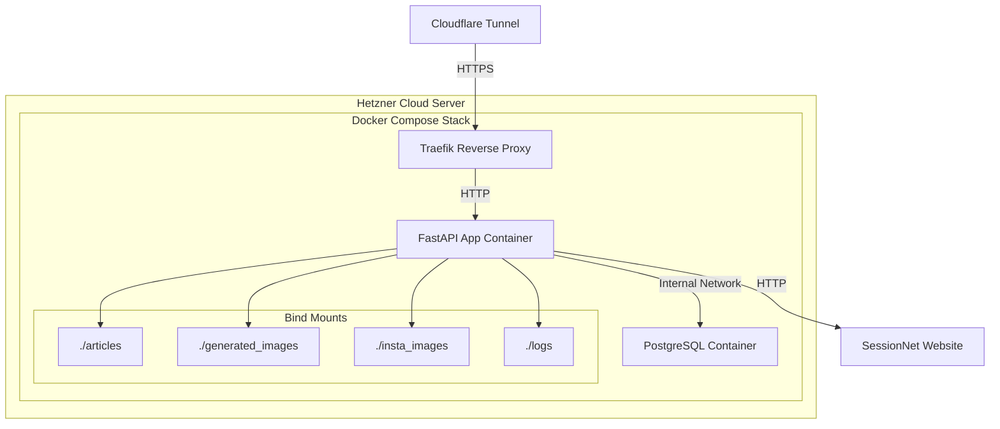

# Containerisierungs-Plan: Gossip Project

## Zusammenfassung

Dieser Plan beschreibt die vollständige Containerisierung der bestehenden Python-Anwendung zu einer produktionsreifen FastAPI-Anwendung mit integriertem Scheduler, PostgreSQL-Datenbank und Traefik-Reverse-Proxy.

---

## System-Architektur



---

## Datenbank-Schema

### Tabelle: protocols

```sql
CREATE TABLE protocols (
    id SERIAL PRIMARY KEY,
    session_date DATE NOT NULL,
    title TEXT NOT NULL,
    getfile_id INTEGER NOT NULL UNIQUE,
    pdf_text TEXT NOT NULL,
    processed BOOLEAN DEFAULT FALSE,
    created_at TIMESTAMP DEFAULT CURRENT_TIMESTAMP
);

-- Indizes
CREATE INDEX idx_protocols_session_date ON protocols(session_date);
CREATE INDEX idx_protocols_getfile_id ON protocols(getfile_id);
CREATE INDEX idx_protocols_processed ON protocols(processed);
```

### Tabelle: articles

```sql
CREATE TABLE articles (
    id SERIAL PRIMARY KEY,
    protocol_id INTEGER REFERENCES protocols(id) ON DELETE CASCADE,
    article_index INTEGER,
    content TEXT NOT NULL,
    created_at TIMESTAMP DEFAULT CURRENT_TIMESTAMP
);

CREATE INDEX idx_articles_protocol_id ON articles(protocol_id);
```

---

## Projektstruktur

```
/workspace/
├── app/
│   ├── __init__.py
│   ├── main.py                    # FastAPI Entry Point
│   ├── config.py                  # Zentrale Konfiguration
│   ├── database.py                # DB-Verbindung & Session Management
│   ├── models.py                  # SQLAlchemy Models
│   ├── scheduler.py               # APScheduler Setup
│   ├── logging_config.py          # Logging-Konfiguration
│   ├── services/
│   │   ├── __init__.py
│   │   ├── protocol_fetcher.py    # HTML Parsing & Download
│   │   ├── protocol_processor.py  # PDF Verarbeitung
│   │   └── duplicate_detector.py  # Duplikat-Erkennung
│   ├── api/
│   │   ├── __init__.py
│   │   └── routes.py              # API Endpoints
│   └── utils/
│       ├── __init__.py
│       └── folder_utils.py        # Ordnerstruktur-Helper
├── alembic/                       # Datenbank-Migrationen
├── articles/                      # Bind Mount
├── generated_images/              # Bind Mount
├── insta_images/                  # Bind Mount
├── logs/                          # Bind Mount
├── Dockerfile
├── docker-compose.yaml
├── requirements.txt
└── .env.example
```

---

## Dockerfile

```dockerfile
FROM python:3.12-slim

WORKDIR /app

# System-Abhängigkeiten
RUN apt-get update && apt-get install -y \
    gcc \
    libpq-dev \
    && rm -rf /var/lib/apt/lists/*

# Python-Abhängigkeiten
COPY requirements.txt .
RUN pip install --no-cache-dir -r requirements.txt

# Anwendungscode
COPY app/ ./app/

# Startkommando
CMD ["uvicorn", "app.main:app", "--host", "0.0.0.0", "--port", "8000"]
```

---

## docker-compose.yaml

```yaml
version: '3.8'

services:
  app:
    build: .
    container_name: gossip-app
    restart: unless-stopped
    env_file: .env
    depends_on:
      postgres:
        condition: service_healthy
    volumes:
      - ./articles:/app/articles
      - ./generated_images:/app/generated_images
      - ./insta_images:/app/insta_images
      - ./logs:/app/logs
    networks:
      - internal
      - traefik
    labels:
      - "traefik.enable=true"
      - "traefik.http.routers.gossip-app.rule=Host(`${TRAEFIK_HOST}`)"
      - "traefik.http.routers.gossip-app.entrypoints=websecure"
      - "traefik.http.routers.gossip-app.tls.certresolver=cloudflare"
      - "traefik.http.services.gossip-app.loadbalancer.server.port=8000"

  postgres:
    image: postgres:16
    container_name: gossip-postgres
    restart: unless-stopped
    env_file: .env
    environment:
      POSTGRES_DB: ${DB_NAME}
      POSTGRES_USER: ${DB_USER}
      POSTGRES_PASSWORD: ${DB_PASSWORD}
    volumes:
      - postgres_data:/var/lib/postgresql/data
    networks:
      - internal
    healthcheck:
      test: ["CMD-SHELL", "pg_isready -U ${DB_USER} -d ${DB_NAME}"]
      interval: 10s
      timeout: 5s
      retries: 5

volumes:
  postgres_data:

networks:
  internal:
    internal: true
  traefik:
    external: true
```

---

## Umgebungsvariablen (.env)

```bash
# Datenbank
DB_HOST=postgres
DB_PORT=5432
DB_NAME=gossip
DB_USER=gossip_user
DB_PASSWORD=secure_password
DATABASE_URL=postgresql://${DB_USER}:${DB_PASSWORD}@${DB_HOST}:${DB_PORT}/${DB_NAME}

# API Keys
GOOGLE_API_KEY=your_google_api_key

# SessionNet
SESSIONNET_BASE_URL=https://sessionnet.owl-it.de/rosdorf/BI/

# Traefik
TRAEFIK_HOST=gossip.yourdomain.com

# Logging
LOG_LEVEL=INFO
```

---

## Scheduler-Konfiguration

```python
from apscheduler.schedulers.asyncio import AsyncIOScheduler
from apscheduler.triggers.cron import CronTrigger

scheduler = AsyncIOScheduler()

# Job 1: Protokolle abrufen (10:00 & 17:00)
scheduler.add_job(
    fetch_protocols_job,
    trigger=CronTrigger(hour="10,17", minute="0"),
    id="fetch_protocols",
    name="Fetch Protocols from SessionNet",
    replace_existing=True
)

# Job 2: Protokolle verarbeiten (10:30 & 17:30)
scheduler.add_job(
    process_protocols_job,
    trigger=CronTrigger(hour="10,17", minute="30"),
    id="process_protocols",
    name="Process Unprocessed Protocols",
    replace_existing=True
)
```

---

## Cron Job Timing

| Job | Uhrzeit | Aufgabe |
|-----|---------|---------|
| fetch_protocols | 10:00 & 17:00 | Webseite abrufen & neue Protokolle speichern |
| process_protocols | 10:30 & 17:30 | Nicht verarbeitete Protokolle verarbeiten |

---

## Duplikat-Erkennung Algorithmus

```python
from difflib import SequenceMatcher

async def check_duplicate(new_pdf_text: str, db_session) -> bool:
    """
    Prüft ob ein ähnliches Protokoll in den letzten 3 Monaten existiert.
    """
    three_months_ago = datetime.now() - timedelta(days=90)
    
    recent_protocols = await db_session.execute(
        select(Protocol).where(Protocol.created_at >= three_months_ago)
    )
    
    for protocol in recent_protocols.scalars():
        similarity = SequenceMatcher(
            None, 
            new_pdf_text, 
            protocol.pdf_text
        ).ratio()
        
        if similarity >= 0.95:
            logger.warning(f"Duplicate detected (similarity: {similarity:.2%})")
            return True
    
    return False
```

---

## Ordnerstruktur-Utility

```python
def create_protocol_folder(session_date: date, title: str) -> Path:
    """
    Erstellt einen normalisierten Ordnernamen für ein Protokoll.
    Format: YYMMDD_normalized_title
    """
    # Umlaute ersetzen
    umlaut_map = {
        'ä': 'ae', 'ö': 'oe', 'ü': 'ue', 'ß': 'ss',
        'Ä': 'Ae', 'Ö': 'Oe', 'Ü': 'Ue'
    }
    
    normalized = title
    for umlaut, replacement in umlaut_map.items():
        normalized = normalized.replace(umlaut, replacement)
    
    # Leerzeichen zu Unterstrichen
    normalized = normalized.replace(' ', '_')
    
    # Nur lowercase
    normalized = normalized.lower()
    
    # Sonderzeichen entfernen
    normalized = re.sub(r'[^a-z0-9_]', '', normalized)
    
    # Max 80 Zeichen
    normalized = normalized[:80]
    
    # Datum prefix
    folder_name = f"{session_date.strftime('%y%m%d')}_{normalized}"
    
    folder_path = Path("/app/articles") / folder_name
    
    if folder_path.exists():
        logger.error(f"Folder already exists: {folder_path}")
        raise FileExistsError(f"Folder {folder_path} already exists")
    
    folder_path.mkdir(parents=True, exist_ok=False)
    return folder_path
```

---

## Logging-Konfiguration

```python
import logging
from datetime import datetime
from pathlib import Path

def setup_logging():
    """
    Konfiguriert Logging nach stdout und monatliche Dateien.
    """
    log_dir = Path("/app/logs")
    log_dir.mkdir(exist_ok=True)
    
    # Monatliche Log-Datei
    log_file = log_dir / f"{datetime.now().strftime('%Y-%m')}.log"
    
    logging.basicConfig(
        level=logging.INFO,
        format='%(asctime)s %(levelname)s %(name)s: %(message)s',
        handlers=[
            logging.StreamHandler(),
            logging.FileHandler(log_file, encoding='utf-8')
        ]
    )
```

---

## SessionNet Parameter-Berechnung

```python
from datetime import datetime, timedelta

def calculate_sessionnet_params():
    """
    Berechnet die Parameter für SessionNet.
    __cmonat = Monat vor exakt 6 Monaten
    """
    now = datetime.now()
    six_months_ago = now - timedelta(days=180)
    
    return {
        "__cjahr": now.year,
        "__cmonat": six_months_ago.month,
        "__canz": 6,
        "smccont": 12,
        "__cselect": 81920
    }
```

---

## Implementierungs-Reihenfolge

1. **Datenbank-Setup**
   - SQLAlchemy Models erstellen
   - Alembic Migrationen einrichten
   - Datenbank-Verbindung konfigurieren

2. **FastAPI Grundgerüst**
   - main.py mit Lifespan-Events
   - Startup: Scheduler starten
   - Shutdown: Scheduler stoppen

3. **Protocol Fetcher Service**
   - HTTP Client (httpx/aiohttp)
   - HTML Parsing (BeautifulSoup)
   - PDF Download mit Retry-Mechanismus

4. **Duplikat-Erkennung**
   - SequenceMatcher Integration
   - 3-Monats-Lookup

5. **Protocol Processor**
   - PDF Text-Extraktion (pymupdf)
   - Bestehende Pipeline-Logik migrieren

6. **Logging & Ordnerstruktur**
   - Monatliche Log-Dateien
   - Protokoll-Ordner-Utility

7. **Docker & Compose**
   - Dockerfile erstellen
   - docker-compose.yaml mit Traefik

8. **Testing & Deployment**
   - Lokale Tests
   - Deployment auf Hetzner

---

## Sicherheitsaspekte

- PostgreSQL nur im internen Netzwerk erreichbar
- Keine exposed Ports für Datenbank
- HTTPS über Traefik/Cloudflare
- Secrets in .env Datei
- Keine GPU erforderlich
- Kein Multi-Worker (Single Worker Uvicorn)
